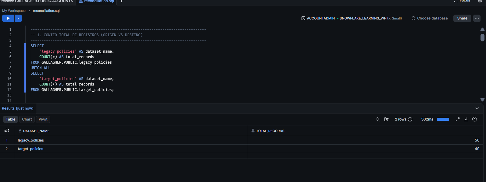
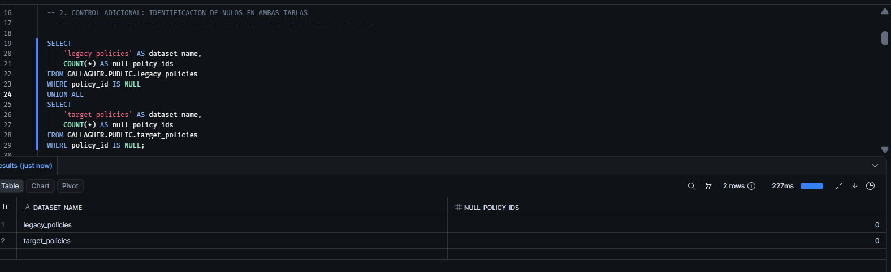
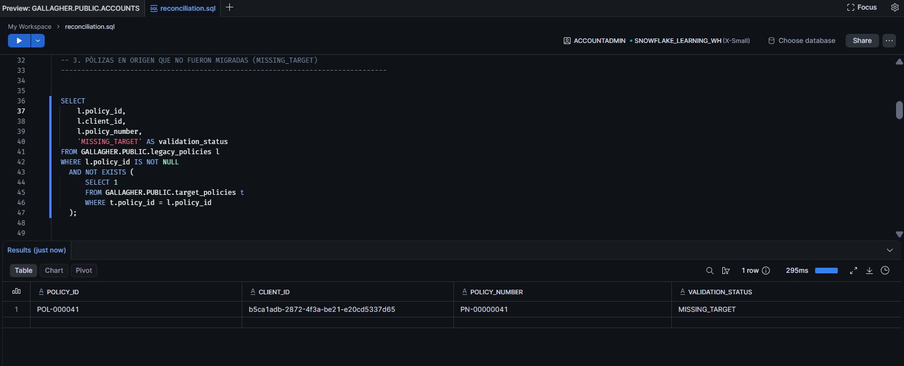
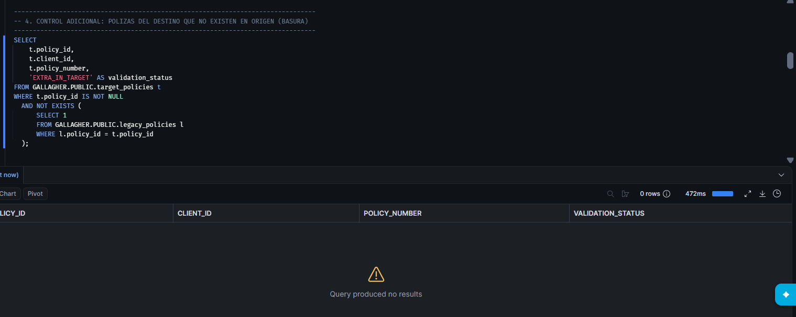
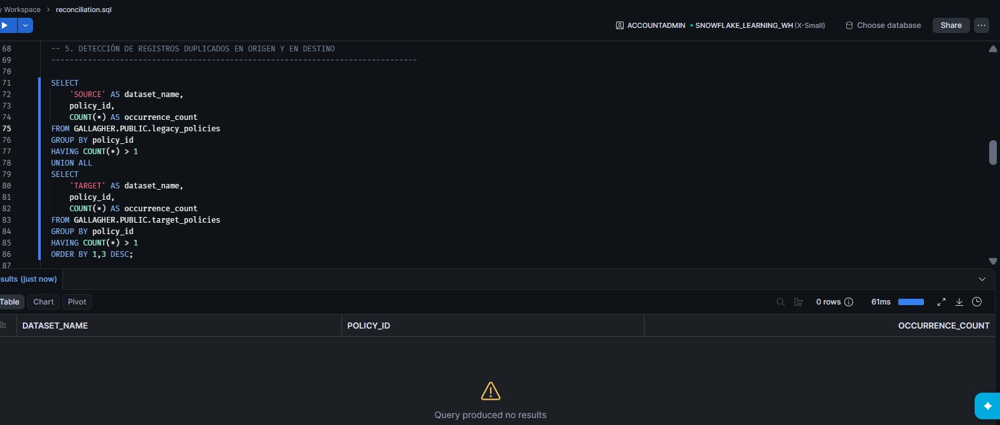
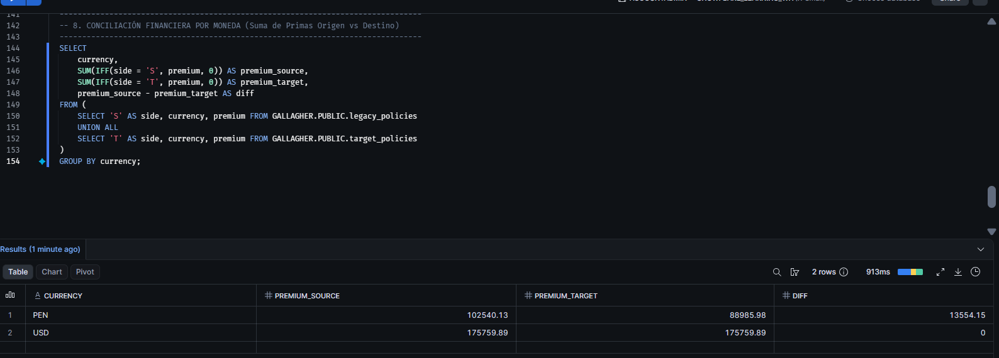

# Gallagher – Prueba Técnica de Data Engineering

Repositorio con la solución integral a los cuatro desafíos técnicos de ingeniería de datos para Gallagher: 

**Framework de Calidad de Datos (P1)**, \
**Conciliación de Migración en Snowflake (P2)**, \
**Consolidación Regional LATAM con dbt (P3)** y \
**Arquitectura End-to-End de Migración Masiva para OPTIMA LATAM (P4)**.

---

## 📂 Estructura del Repositorio

El repositorio está organizado modularmente por pregunta para facilitar su navegación, revisión de evidencias y reproducibilidad:

| Carpeta / Archivo | Pregunta | Contenido Principal |
| :--- | :---: | :--- |
| [`Enunciado/`](Enunciado/) | Base | Datasets CSV originales entregados: [`accounts.csv`](Enunciado/accounts.csv) , [`legacy_policies.csv`](Enunciado/legacy_policies.csv), [`target_policies.csv`](Enunciado/target_policies.csv). |
| [`Pregunta1/`](Pregunta1/) | **P1** | Motor y scripts de validación de calidad de datos ([`quality_framework.py`](Pregunta1/quality_framework.py)), reglas y logs de ejecución [`dq_execution_log.txt`](Pregunta1/dq_execution_log.csv). |  
| [`Pregunta2/`](Pregunta2/) | **P2** | Script de auditoría y conciliación en Snowflake ([`reconciliation.sql`](Pregunta2/reconciliation.sql)), reportes CSV ([`Auditoria.csv`](Pregunta2/Auditoria.csv), [`duplicados_src.csv`](Pregunta2/duplicados_src.csv)) y evidencias gráficas. |
| [`Pregunta3/`](Pregunta3/) | **P3** | Modelos de transformación modular en dbt: configuración de fuentes [`_sources.yml`](Pregunta3/_sources.yml) , capa *staging*, *intermediate* y tabla final [`fact_policy.sql`](Pregunta3/fact_policy.sql). |
| [`Pregunta4/`](Pregunta4/) | **P4** | Diseño de arquitectura End-to-End. |

---

---

## Cómo Ejecutar (Reproducibilidad)

Prerrequisitos: Python 3.11 o superior. Para P2 y P3, contar con acceso a Snowflake (usando un rol funcional de menor privilegio, no ACCOUNTADMIN), SnowSQL y dbt-snowflake.

### 1. Instalación del entorno y validaciones locales (P1 y Linting)
Desde la carpeta raíz del repositorio, instala las dependencias utilizando el archivo de requerimientos ejecutando: pip install -r requirements.md

Una vez instaladas las dependencias, dirígete a la carpeta Pregunta1 y ejecuta el framework de calidad de datos escribiendo: 

cd Pregunta1 \
python3 quality_framework.py.

(Esto procesará los CSV ubicados en Enunciado/ preservando los formatos de texto y generará el archivo de salida dq_execution_log.txt en la misma carpeta).

### 2. Conciliación en Snowflake (P2)
Ejecutar el script de auditoría y conciliación conectándose a la instancia de Snowflake mediante:\ snowsql -f Pregunta2/reconciliation.sql

### 3. Transformación con dbt (P3)
Ejecutar mediante: make dbt (Ejecuta dbt deps + dbt build para modelos y tests de calidad)

---

## 🛡️ Punto 1: Framework de Calidad de Datos (Python)

- **Implementación:** Desarrollo del script [`quality_framework.py`](Pregunta1/quality_framework.py) para la lectura segura, perfilamiento y validación estructurada de los conjuntos de datos [`accounts.csv`](Enunciado/accounts.csv), [`legacy_policies.csv`](Enunciado/legacy_policies.csv) y [`target_policies.csv`](Enunciado/target_policies.csv).

### Decisiones de Diseño del Motor y Arquitectura
- **Modelado Tipado con Dataclasses (`Rule`):** Las reglas de validación se estructuran formalmente mediante clases de datos inmutables (`@dataclass(frozen=True)`), estandarizando atributos como nombre, dimensión de calidad, severidad, dataset objetivo, llave y función de verificación.
- **Dimensiones de Calidad (ISO/IEC 25012):** Clasificación formal de las anomalías detectadas bajo estándares internacionales (*Validez*, *Unicidad*, *Completitud*, *Integridad Referencial*, *Consistencia*).
- **Validaciones Cruzadas y Entre Tablas:** El motor procesa el diccionario global de datasets, permitiendo ejecutar reglas de fila, de conjunto y de integridad referencial (ej. detección de pólizas huérfanas cruzando `target_policies` contra `accounts`).
- **Control de Estados y Manejo de Errores (`PASSED / FAILED / ERROR`):** Uso de logging formal (`logging.exception`) para evitar falsos negativos silenciosos. Cualquier fallo de ejecución técnica se registra como `ERROR` y finaliza el proceso con código de salida no cero (`sys.exit(1)`).
- **Mapeo Estricto de Llaves Primarias (`PRIMARY_KEYS`):** Configuración específica por dataset para asegurar que los reportes muestren con precisión el identificador correspondiente (`client_id` o `policy_id`) sin mezclar campos homónimos.
- **Portabilidad de Rutas:** Resolución de rutas dinámicas mediante `os.path`, garantizando su ejecución nativa en cualquier entorno sin rutas absolutas cableadas.
- **Lectura segura de tipos (`dtype=str`):** Procesamiento de CSVs preservando identificadores y ceros a la izquierda (como el dígito verificador `K` en RUTs chilenos).
- **Niveles de Severidad:**
  * `CRITICAL`: Bloquea la migración del registro y lo desvía a cuarentena (DLQ).
  * `WARNING`: Permite migrar el registro marcándolo con una bandera de auditoría para su remediación en el origen.
- **Trazabilidad y Evidencias:** Generación automática del archivo de salida [`dq_execution_log.txt`](Pregunta1/dq_execution_log.txt) estructurado con el resumen de estados y detalle de incidencias agrupadas.

### Hallazgos Principales en los Datos Entregados (Log de Ejecución Real)
La ejecución validada del framework sobre los datasets reporta el siguiente consolidado de incidencias reales capturadas por el motor:

| Anomalía / Regla Detectada | Dataset | Dimensión | Severidad | Registros Afectados / Hallazgo | Acción Recomendada |
| :--- | :---: | :---: | :---: | :---: | :--- |
| **Correos Inválidos / Placeholder (`Malformed_Email`)** | `accounts` | Validez | `WARNING` | `100` registros | Migrar como `NULL` con bandera de calidad. |
| **Inconsistencia País vs. Documento (`Country_Document_Mismatch`)** | `accounts` | Consistencia | `WARNING` | `98` registros | Homologar catálogo de tipos de documento con negocio. |
| **Teléfono Centinela (`Sentinel_Phone`)** | `accounts` | Validez | `WARNING` | `51` registros (`7010001`) | Migrar como `NULL` con bandera de calidad. |
| **Pólizas con Inicio Futuro (`Future_Start_Date`)** | `target_policies` | Validez | `WARNING` | `11` registros | Validar definición de estado `ACTIVE` vs. `PENDING`. |
| **Titulares Menores de Edad (`Underage_At_Creation`)** | `accounts` | Validez | `WARNING` | `5` registros | Validar reglas de suscripción de la cuenta. |
| **Documentos con Longitud Anómala (`Invalid_Document_Length`)** | `accounts` | Validez | `CRITICAL` | `3` registros (5, 6 u 11 dígitos) | Corregir en origen antes de migrar. |
| **Pólizas Activas en Clientes Inactivos (`Active_Policy_Inactive_Client`)** | `target_policies` | Consistencia | `WARNING` | `3` registros (`POL-000010`, `034`, `049`) | Revisar estado del cliente o vigencia. |
| **Clientes Duplicados por Documento (`Duplicate_Document`)** | `accounts` | Unicidad | `CRITICAL` | `2` registros (ej. Miguel Vargas) | Unificar aplicando regla de supervivencia. |
| **Fechas de Nacimiento Imposibles (`Invalid_Birthdate_Range`)** | `accounts` | Validez | `CRITICAL` | `2` registros (años 1880 y 1893) | Corregir en origen. |
| **Póliza Huérfana (`Orphan_Policy`)** | `target_policies` | Integridad Referencial | `CRITICAL` | `1` registro (`POL-000008`) | Bloquear carga y corregir referencia del `client_id`. |


## 🔍 Punto 2: Validación y Conciliación de Datos (Snowflake)

- **Implementación:** Carga de datos en Snowflake estandarizando formatos de fecha (`DD/MM/YYYY`) y tipado numérico exacto (`NUMBER(18,2)` para primas).
- **Script de Auditoría:** [`reconciliation.sql`](Pregunta2/reconciliation.sql) diseñado para auditar paridad volumétrica, financiera, integridad referencial y consistencia campo a campo.

### Resumen Ejecutivo de la Conciliación
Se identificaron **50 pólizas en origen (`legacy`)** y **49 en destino (`target`)**, con el siguiente balance de control:

| Control de Auditoría | Resultado Obtenido |
| :--- | :--- |
| **Registros Origen vs. Destino** | `50` / `49` (38 `OK`, 11 `ERROR`, 1 `MISSING_TARGET`) |
| **Pólizas no migradas (`MISSING_TARGET`)** | `POL-000041` |
| **Registros fantasma solo en destino (`MISSING_SOURCE`)** | Ninguno (`0`) |
| **Pólizas con discrepancias de atributos (`ERROR`)** | `POL-000008` (`client_id`), `POL-000030` a `037` (`start_date`), `POL-000038` (`start_date`, `end_date`), `POL-000047` (`premium`) |
| **Duplicados de pólizas (`policy_id`, `policy_number`, fila)** | Ninguno en origen ni en destino (`0`) |
| **Clientes duplicados por documento** | RUT `966030828` (Miguel Vargas) con 2 `client_id` |
| **Clientes con múltiples pólizas en el origen** | `12` clientes (detalle en [`duplicados_src.csv`](Pregunta2/duplicados_src.csv)) |
| **Suma de Primas (Origen vs. Destino)** | `$278,300.02` vs. `$264,745.87` |
| **Varianza Financiera Total** | `-$13,554.15` $\rightarrow$ explicada exactamente por `POL-000041` (`$7,215.12` no migrada) + `POL-000047` (`$6,339.03` de diferencia en prima) |
| **Pólizas huérfanas (sin cliente en `accounts`)** | `POL-000008` en destino |

### Decisiones Técnicas en SQL
- **Comparación segura de atributos (`IS NOT DISTINCT FROM`):** Se utiliza este operador nativo de Snowflake para evaluar la igualdad campo a campo, asegurando que un valor `NULL` en ambos lados se trate correctamente como coincidencia (`OK`), mientras que cualquier asimetría dispare una discrepancia (`ERROR`).
- **Auditoría modular y simétrica:** Se emplea una combinación de `LEFT JOIN` (para aislar registros faltantes en destino como `MISSING_TARGET`) y consultas de exclusión cruzada (para detectar excesos no autorizados como `EXTRA_IN_TARGET`), garantizando un control volumétrico y de integridad estricto.
- **Deduplicación y trazabilidad de diferencias (`CONCAT` / `IFF`):** Construcción de dinámicas de campos disímiles (`fields_with_differences`) para identificar exactamente qué atributo a nivel de columna (ej. `premium`, `client_id`, `start_date`) causó la variación financiera o de negocio.
### 📸 Evidencias Gráficas y Archivos de Ejecución

2.1. **Conteo Volumétrico (Comparativa de registros totales):**


2.2. **Control de Nulos en Origen y Destino:**


2.3. **Registros Faltantes / Sin Migrar (`legacy` vs. `target`):**


2.4. **Control de Pólizas en Destino Inexistentes en Origen (`MISSING_SOURCE`):**


2.5. **Detección de Duplicados en Origen y Destino:**


2.6. **Clientes con más de una póliza en el origen:**
- Exportación de clientes con múltiples pólizas activas/históricas en el sistema legado: [`duplicados_src.csv`](Pregunta2/duplicados_src.csv).

2.7. **Auditoría Detallada Campo por Campo:**
- Validación a nivel de atributo (`premium`, `currency`, `start_date`, `end_date`, `status`) clasificada por estado (`OK` / `ERROR`): [`Auditoria.csv`](Pregunta2/Auditoria.csv).

2.8. 💵 Conciliación Financiera por Moneda y Análisis de Varianza

La auditoría financiera global compara la suma de primas entre el sistema de origen (`legacy_policies`) y el destino (`target_policies`), segmentada por moneda para garantizar trazabilidad contable al centavo.

**Evidencia de Ejecución (Snowflake):**


* **Resumen de Cuadre Financiero:**
  * **USD:** Cuadre perfecto con **$175,759.89** tanto en origen como en destino ($\text{Diferencia} = \$0.00$), garantizando que la cartera en dólares migró sin alteraciones.
  * **PEN:** Presenta un total de **$102,540.13** en origen frente a **$88,985.98** en destino, arrojando una varianza contable neta de **$13,554.15** en Soles peruanos.

---

### 💡 Conclusiones de Negocio a Partir de los Resultados

1. **Explicación Causal y Exacta de la Varianza Financiera:**
   La diferencia de **$13,554.15** en la moneda local no representa un error sistémico ni una pérdida de dinero no controlada; está matemáticamente explicada y reconciliada por dos eventos específicos identificados en la migración:
   * **$7,215.12** corresponden a la póliza **`POL-000041`**, la cual se quedó rezagada en el sistema legado y **no fue migrada** (`MISSING_TARGET`).
   * **$6,339.03** corresponden a la discrepancia de valor en la prima de la póliza migrada **`POL-000047`** (`ERROR` por alteración de atributo en destino).
   * *Suma de control:* $\$7,215.12 + \$6,339.03 = \mathbf{\$13,554.15}$. Este nivel de precisión es el requisito indispensable exigido por el área de Finanzas para firmar el acta de aceptación (*Go-Live*).

2. **Mitigación de Riesgos de Suscripción por Datos Incompletos:**
   La existencia de la póliza no migrada (`POL-000041`) y el registro huérfano detectado (`POL-000008`, que apunta a un `client_id` inexistente en `accounts`) evidencian la necesidad imperativa de ejecutar barreras de validación relacional antes de abrir los canales transaccionales a los usuarios de negocio en OPTIMA LATAM.

3. **Estrategia de Saneamiento y Cierre de Brechas (*Data Remediation*):**
   * **Acción Inmediata 1:** Inyectar manualmente la póliza rezagada `POL-000041` junto con su cliente asociado en el entorno de destino.
   * **Acción Inmediata 2:** Corregir el monto de la prima de la póliza `POL-000047` para nivelar la contabilidad en Soles (`PEN`).
   * **Criterio de Aceptación Final:** Una vez ejecutadas estas dos correcciones, la varianza financiera será exactamente **$0.00**, permitiendo al comité técnico firmar el certificado de salida a producción sin reparos de auditoría.


---

## 🏗️ Punto 3: Consolidación Regional LATAM con dbt (OneSource)

Diseño de arquitectura modular en **dbt** para estandarizar e integrar las tablas regionales de seguros (`RAW_PERU.POLICIES`, `RAW_CHILE.POLICIES`, `RAW_COLOMBIA.POLICIES`) en el modelo analítico corporativo **`ANALYTICS.FACT_POLICY`**.

### 📊 1. Diagrama de Linaje (dbt Lineage)

```mermaid
graph LR
    subgraph Fuentes_RAW [Snowflake RAW Schemas]
        A[RAW_PERU.POLICIES]
        B[RAW_CHILE.POLICIES]
        C[RAW_COLOMBIA.POLICIES]
    end

    subgraph Staging_Layer [Capa Staging · Vistas]
        D[stg_peru_policies]
        E[stg_chile_policies]
        F[stg_colombia_policies]
    end

    subgraph Intermediate_Layer [Capa Intermediate]
        G[int_latam_policies_unioned]
    end

    subgraph Marts_Layer [Capa Marts / Analytics]
        H[(ANALYTICS.FACT_POLICY)]
    end

    A --> D
    B --> E
    C --> F
    D --> G
    E --> G
    F --> G
    G --> H

## 🏛️ 2. Arquitectura en Capas y Responsabilidades

| Capa | Materialización | Responsabilidad Técnica |
| :--- | :---: | :--- |
| **Sources (`_sources.yml`)** | Tablas RAW | Declaración modular por esquema (`raw_peru`, `raw_chile`, `raw_colombia`) con monitoreo de frescura (*freshness*) y control de carga (`_loaded_at`). |
| **Staging (`models/staging/`)** | Vistas (`view`) | Estandarización de tipos (`try_to_date`), conversión de texto a mayúsculas/minúsculas, mapeo de `policy_id` a `policy_key`, inyección del código de país (`country_code`) y manejo seguro de nulos (`coalesce(premium, 0)`). Utilizan la referencia `source('raw_<pais>', 'policies')`. |
| **Intermediate (`models/intermediate/`)** | Efímero (`ephemeral`) | Unificación estructural (`UNION ALL`) de los tres países mediante el modelo [`int_latam_policies_unioned.sql`](Pregunta3/int_latam_policies_unioned.sql). |
| **Marts (`models/marts/`)** | Tabla (`table`) | Construcción de [`fact_policy.sql`](Pregunta3/fact_policy.sql) generando llaves subrogadas mediante `dbt_utils.generate_surrogate_key` a partir de `country_code` y `policy_key`. |
