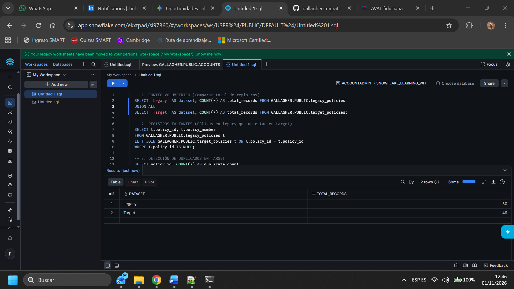
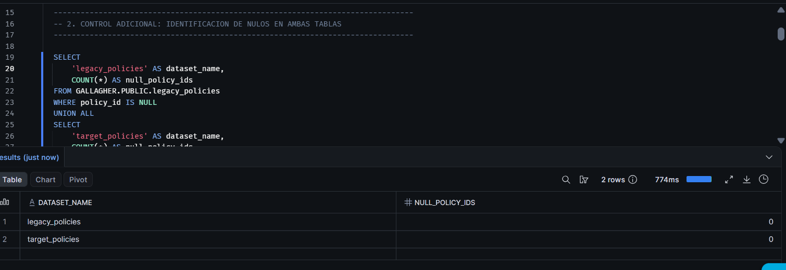
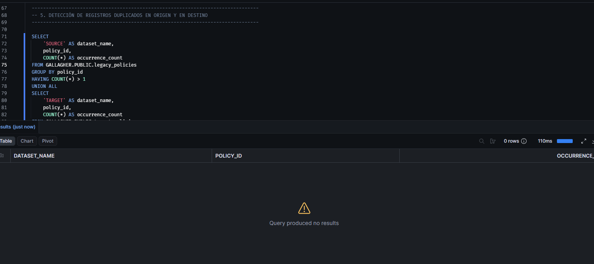
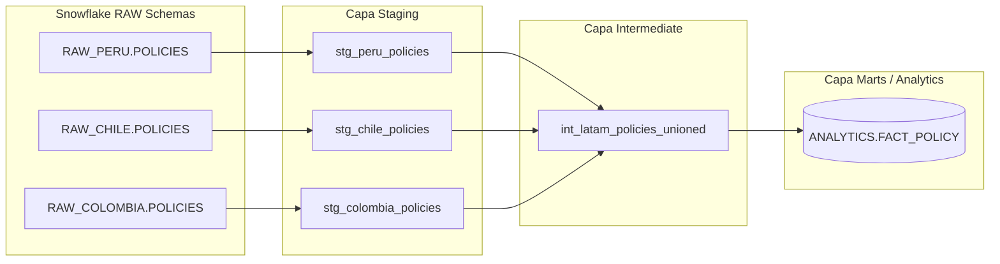
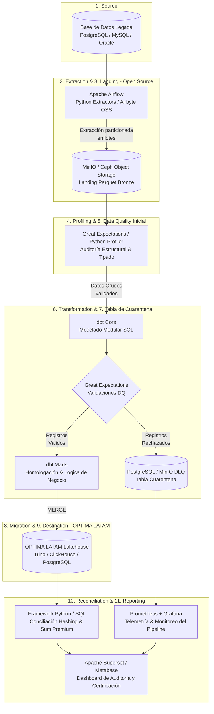

# Gallagher Data Engineering Technical Assessment

## Descripción del Proyecto
Este repositorio contiene la solución para la prueba técnica de ingeniería de datos para Gallagher, enfocada en la migración, validación y conciliación de pólizas.

## Progreso y Componentes

- **Punto 1: Procesamiento Inicial con Python**
  - Implementación de scripts en Python (`quality_framework.py`) para la lectura, análisis y preparación de los conjuntos de datos (`legacy_policies` y `target_policies`).

- **Punto 2: Validación y Conciliación de Datos (Snowflake)**
  - Carga de datos en Snowflake manejando los formatos de fecha `DD/MM/YYYY`.
  - Script implementado en `reconciliation.sql` para auditar la integridad de la migración.

  ### Evidencias Gráficas (Imágenes):
  2.1. **Conteo Volumétrico (Comparativa de registros totales):**
     


  2.2. **Control Adicional / Nulos en Origen y Destino:**
     

  2.3. **Registros Faltantes / Sin Migrar (Pólizas en legacy no encontradas en target):**
     

  2.4. **Control Adicional / Polizas del destino que no existen en origen (BASURA):**
     

  2.5. **Detección de Duplicados en el Origen y destino:**
     

  2.6. **Clientes con más de una poliza en el origen:**
     - Identificación de clientes que poseen más de una póliza registrada dentro del sistema legacy.
    
  2.7. **Auditoría Campo por Campo (`Pregunta2/Auditoria.csv`):**
     - Validación detallada de atributos críticos (`premium`, `currency`, `start_date`, `end_date`, `status`) con indicadores de estatus (`OK` / `ERROR`).

 - **Punto 3: Arquitectura y Modelado en dbt (Consolidación LATAM - OneSource)**
  - Diseño de arquitectura en capas utilizando dbt para estandarizar y consolidar las fuentes regionales (`RAW_PERU.POLICIES`, `RAW_CHILE.POLICIES`, `RAW_COLOMBIA.POLICIES`) en un único dataset analítico corporativo: `ANALYTICS.FACT_POLICY`.

  ### 🏗️ 1. Arquitectura en Capas
  La solución propuesta en dbt, consiste en tres capas principales:

  * **Capa Staging (`models/staging/`):** 
    * Conexión directa a las tablas RAW de cada país.
    * Estandarización de nombres de columnas, normalización de tipos de datos, limpieza de valores nulos y estandarización de monedas y estados.
  * **Capa Intermediate (`models/intermediate/`):** 
    * Realiza el cruce y unificación (`UNION ALL`) de los datos limpios provenientes de los diferentes países.
    * Aplica lógica de negocio transversal antes de llegar al modelo final.
  * **Capa Marts / Analytics (`models/marts/`):** 
    * Genera la tabla analítica final materializada como tabla (`ANALYTICS.FACT_POLICY`) lista para herramientas de BI y consumo corporativo de OneSource.

  ---

  ### 📂 2. Estructura del Proyecto dbt
  ```text
  gallagher_transform/
  ├── dbt_project.yml
  ├── profiles.yml
  └── models/
      ├── staging/
      │   ├── _sources.yml
      │   ├── stg_peru_policies.sql
      │   ├── stg_chile_policies.sql
      │   └── stg_colombia_policies.sql
      ├── intermediate/
      │   └── int_latam_policies_unioned.sql
      └── marts/
          └── fact_policy.sql
```
### 💻 3. Implementación de Modelos Clave (Código Fuente)

  Para la evaluación de esta arquitectura, se muestra el código fuente de los modelos adjuntos en este repositorio haciendo clic en los siguientes enlaces:

  * **[Definición de Fuentes (`_sources.yml`)](_sources.yml):** Configuración y mapeo de las tablas originales en el esquema `RAW_DB` para Perú, Chile y Colombia.
  * **[Modelo Staging - Ejemplo Colombia (`stg_colombia_policies.sql`)](stg_colombia_policies.sql):** Lógica de limpieza, casteo de formatos de fecha, manejo de nulos y estandarización de la fuente colombiana.
  * **[Modelo Intermedio (`int_latam_policies_unioned.sql`)](int_latam_policies_unioned.sql):** Integración (`UNION ALL`) de las tablas regionales estandarizadas en una única capa unificada.
  * **[Modelo Final Analytics (`fact_policy.sql`)](fact_policy.sql):** Construcción de la tabla final corporativa con generación de llaves  (`policy_sk`) y metadata de actualización para OneSource.

  ### 🎯  Justificación de Decisiones de Diseño
  1. **Modularidad y Reutilización:** Aislar las fuentes por país en la capa de *staging* permite absorber cambios en los sistemas locales (ej. si Perú cambia el formato de fecha) sin alterar los modelos intermedios ni los reportes finales.
  2. **Estandarización Temprana:** La limpieza de nulos (`COALESCE`), el casteo de tipos y la normalización de textos se ejecutan al inicio, garantizando que el consumo analítico sea consistente en las capas superiores.
  3. **Escalabilidad Geográfica:** Incorporar un nuevo país a la plataforma OneSource solo requiere la creación de un nuevo script `stg_<pais>_policies.sql` y su incorporación en el `UNION ALL` del modelo intermedio, manteniendo intacta la lógica de negocio de la tabla final (`fact_policy.sql`).


### 📊 Diagrama de Arquitectura (Lineage dbt)


- **Punto 4: Diseño de Solución End-to-End para Migración Masiva (OPTIMA LATAM)**

Solución de arquitectura para la incorporación masiva de un nuevo país a la plataforma corporativa OPTIMA LATAM, gestionando una volumetría estimada de **500,000 clientes, 2,000,000 de pólizas, 8,000,000 de ítems y 1,500,000 de endosos (~12 millones de registros en total)**.

### 🏗️ 1. Diagrama de Arquitectura End-to-End


### 📋 2. Descripción de Componentes y Funciones del Pipeline

La siguiente matriz detalla el rol técnico, las herramientas y la responsabilidad de cada etapa en el ciclo de vida de la migración de los ~12 millones de registros hacia la plataforma corporativa OPTIMA LATAM:

| Etapa / Componente | Tecnología de Referencia (Open Source / Agnóstica) | Función Principal y Responsabilidad Técnica |
| :--- | :--- | :--- |
| **1. Source (Origen)** | RDBMS Legado (PostgreSQL / Oracle / MySQL) | Sistema transaccional del país a migrar. Aloja los datos históricos no estandarizados de clientes (500k), pólizas (2M), ítems (8M) y endosos (1.5M). |
| **2. Extraction (Extracción)** | Apache Airflow / Python Extractors | Orquesta extracciones concurrentes y particionadas (por rangos de ID o fecha) en lotes controlados para evitar saturación de recursos o bloqueos en la base de datos productiva. |
| **3. Landing / RAW (Aterrizaje)** | MinIO / Ceph (Object Storage compatible S3) | Zona de almacenamiento inmutable (*Bronze Layer*) que recibe los datos crudos extraídos en formato Parquet comprimido con Snappy, garantizando desacoplamiento y persistencia temporal para auditorías. |
| **4. Profiling (Perfilamiento)** | Python Profiler (Pandas/Polars) / Scripts SQL | Análisis exploratorio automatizado previo a la carga: distribución de frecuencias, conteo de nulos, detección de formatos atípicos y cardinalidad de llaves foráneas. |
| **5. Pre-ingestion Data Quality** | Great Expectations / Validadores Schema | Control preventivo de calidad estructural: verificación de tipados, no nulidad de identificadores críticos y detección temprana de esquemas corruptos antes del modelado. |
| **6. Mapping (Homologación)** | dbt Seeds / Tablas Maestras de Catálogo | Matriz de correspondencia corporativa que traduce catálogos locales y heterogéneos (códigos de ramo, monedas locales, planes, tipos de documento) a los estándares globales de OPTIMA. |
| **7. Transformation (Transformación)** | dbt Core (Staging $\rightarrow$ Intermediate $\rightarrow$ Marts) | Procesamiento modular en SQL con control de versiones. Aplica limpieza de textos, normalización de vigencias, resolución de llaves subrogadas (`Surrogate Keys` con hash) y reglas de negocio. |
| **7.1. Dead Letter Queue (DLQ)** | Tablas de Cuarentena (PostgreSQL / MinIO) | Aislamiento automático de registros que incumplen reglas de negocio o presentan referencias huérfanas, almacenando el payload crudo, el código de falla y la marca de tiempo para no abortar el pipeline. |
| **8. Migration (Carga)** | Pipeline ELT Idempotente | Ejecución controlada de la carga en dos fases: carga masiva histórica en frío (*Bulk Load* hasta $T-1$) y sincronización incremental final (*Delta Sync*) durante la ventana de corte. |
| **9. Destination (Destino)** | Lakehouse / Data Warehouse (Trino / ClickHouse / Snowflake) | Repositorio corporativo analítico y transaccional centralizado (*Gold Layer* en esquema `OPTIMA_LATAM`), estructurado para consultas masivas de alta velocidad y analítica transversal. |
| **10. Reconciliation (Conciliación)** | Engine de Conciliación SQL / Scripts Python | Auditoría automatizada de paridad volumétrica (conteos totales), sumatorias de control financiero ($\sum \text{Premium}$) y paridad campo a campo mediante hashing (`SHA256`). |
| **11. Reporting & Observability** | Apache Superset / Metabase + Prometheus / Grafana | Tablero ejecutivo en tiempo real para seguimiento del progreso del corte (*Go/No-Go*), monitoreo de throughput (registros/segundo) y métricas de registros desviados a la DLQ. |


### 3. Justificación Tecnológica (Agnóstico / Open Source)

Elegí herramientas open source (Parquet, SQL con dbt, Airflow) para evitar depender de un solo proveedor (*Vendor Lock-in*). Esto significa que la solución es portátil: se puede montar en Azure, AWS o servidores locales, ajustándose a lo que tenga cada país y pagando solo por el almacenamiento y cómputo que realmente se use.

### 4. Estrategias Técnicas de Migración

* **Manejo de Grandes Volúmenes (~12M de registros):** Extraemos los datos por partes (lotes) y en paralelo para no colapsar la base de datos de origen. La ingesta se hace en orden estricto (Clientes $\rightarrow$ Pólizas $\rightarrow$ Ítems/Endosos) para que ningún dato quede "huérfano".
* **Calidad de Datos (Data Quality):** Validamos en tres filtros: estructural (sin nulos ni duplicados), relacional (que todo coincida) y negocio (fechas lógicas, catálogos estándar).
* **Manejo de Errores (Dead Letter Queue - DLQ):** Si un dato viene mal, no frenamos todo. Se manda a una tabla de "cuarentena" (DLQ) para revisarlo después. Además, usamos cargas seguras (`MERGE INTO`) para que si algo falla y toca repetir, no se dupliquen los datos.
* **Fases de Migración:** Para no afectar la operación, lo dividimos en tres: 1) Carga histórica gigante (hasta un día antes); 2) Sincronización de lo nuevito (delta); 3) Fin de semana de "corte" final (se bloquea el origen y se prende el nuevo).
* **Conciliación (Origen vs. Destino):** Cuadramos todo al centavo. Validamos que el total de registros coincida, que la plata sume lo mismo y usamos un código criptográfico (hash) para asegurar que cada campo sea idéntico.
* **Métricas y Monitoreo:** Medimos la velocidad en tiempo real y aseguramos un 99.5% de éxito. Todo se muestra en un tablero que sirve como "firma" para dar el visto bueno al salir a producción.
   Migración Incremental y por Lotes: Estrategia en tres fases mitigando el downtime: 1) Carga histórica masiva en frío hasta $T-1$; 2) Sincronización de deltas incrementales recientes; 3) Ventana de corte final (Cutover) bloqueando el sistema legado en modo solo lectura.
   Conciliación entre Origen y Destino: Cuadre de auditoría en tres ejes: balance volumétrico exacto, control financiero agregado ($\sum \text{Premium}_{\text{Origen}} \equiv \sum \text{Premium}_{\text{Destino}}$), y paridad campo a campo generada por hashing criptográfico (SHA256).
   Métricas e Informes de Avance: Monitoreo en tiempo real del throughput de ingestión y la efectividad de carga ($\ge 99.5\%$). Tablero ejecutivo visual utilizado como certificado formal de auditoría para firmar la salida a producción (Go / No-Go).
