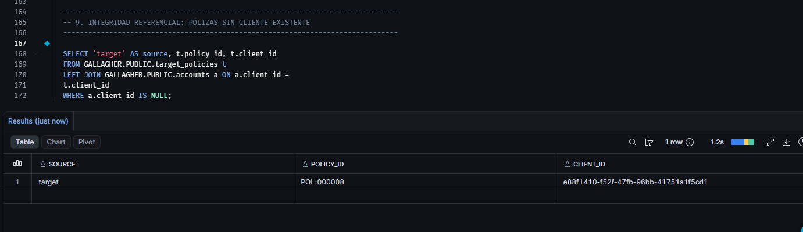
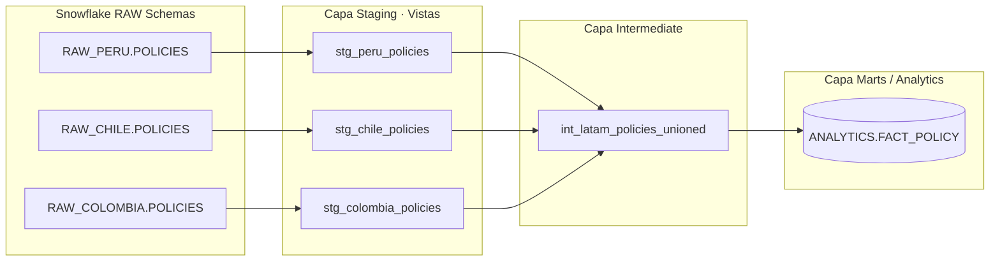
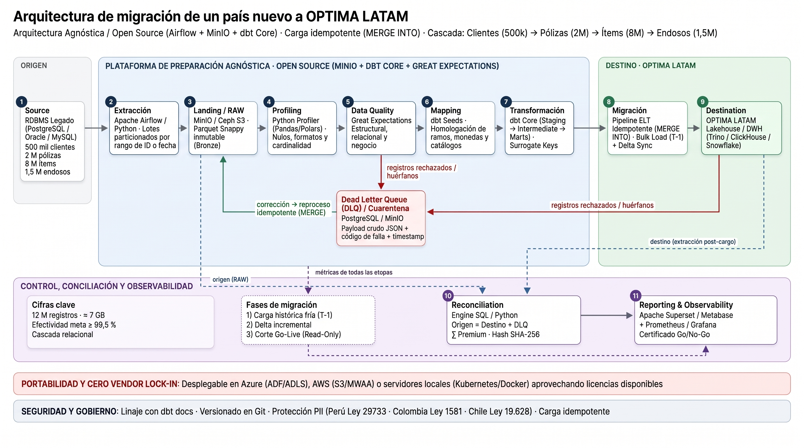

# Gallagher – Prueba Técnica de Data Engineering

Repositorio con la solución integral a los cuatro desafíos técnicos de ingeniería de datos para Gallagher: 

**Framework de Calidad de Datos (P1)**, \
**Conciliación de Migración en Snowflake (P2)**, \
**Consolidación Regional LATAM con dbt (P3)** y \
**Arquitectura End-to-End de Migración Masiva para OPTIMA LATAM (P4)**.

---

## 📂 Estructura del Repositorio

El repositorio está organizado modularmente por pregunta para facilitar su navegación, revisión de evidencias y reproducibilidad:

| Carpeta / Archivo | Pregunta | Contenido Principal |
| :--- | :---: | :--- |
| [`Enunciado/`](Enunciado/) | Base | Datasets CSV originales entregados: [`accounts.csv`](Enunciado/accounts.csv) , [`legacy_policies.csv`](Enunciado/legacy_policies.csv), [`target_policies.csv`](Enunciado/target_policies.csv). |
| [`Pregunta1/`](Pregunta1/) | **P1** | Motor y scripts de validación de calidad de datos ([`quality_framework.py`](Pregunta1/quality_framework.py)), reglas y logs de ejecución [`dq_execution_log.txt`](Pregunta1/dq_execution_log.csv). |  
| [`Pregunta2/`](Pregunta2/) | **P2** | Script de auditoría y conciliación en Snowflake ([`reconciliation.sql`](Pregunta2/reconciliation.sql)), reportes CSV ([`Auditoria.csv`](Pregunta2/Auditoria.csv), [`duplicados_src.csv`](Pregunta2/duplicados_src.csv)) y evidencias gráficas. |
| [`Pregunta3/`](Pregunta3/) | **P3** | Modelos de transformación modular en dbt: configuración de fuentes [`_sources.yml`](Pregunta3/_sources.yml) , capa *staging*, *intermediate* y tabla final [`fact_policy.sql`](Pregunta3/fact_policy.sql). |
| [`Pregunta4/`](Pregunta4/) | **P4** | Diseño de arquitectura End-to-End. |

---

---

## Cómo Ejecutar (Reproducibilidad)

Prerrequisitos: Python 3.11 o superior. Para P2 y P3, contar con acceso a Snowflake (usando un rol funcional de menor privilegio, no ACCOUNTADMIN), SnowSQL y dbt-snowflake.

### 1. Instalación del entorno y validaciones locales (P1 y Linting)
Desde la carpeta raíz del repositorio, instala las dependencias utilizando el archivo de requerimientos ejecutando: pip install -r requirements.md

Una vez instaladas las dependencias, dirígete a la carpeta Pregunta1 y ejecuta el framework de calidad de datos escribiendo: 

cd Pregunta1 \
python3 quality_framework.py.

(Esto procesará los CSV ubicados en Enunciado/ preservando los formatos de texto y generará el archivo de salida dq_execution_log.txt en la misma carpeta).

### 2. Conciliación en Snowflake (P2)
Ejecutar el script de auditoría y conciliación conectándose a la instancia de Snowflake mediante:\ snowsql -f Pregunta2/reconciliation.sql

### 3. Transformación con dbt (P3)
Ejecutar mediante: make dbt (Ejecuta dbt deps + dbt build para modelos y tests de calidad)

---

## 🛡️ Punto 1: Framework de Calidad de Datos (Python)

- **Implementación:** Desarrollo del script [`quality_framework.py`](Pregunta1/quality_framework.py) para la lectura segura, perfilamiento y validación estructurada de los conjuntos de datos [`accounts.csv`](Enunciado/accounts.csv), [`legacy_policies.csv`](Enunciado/legacy_policies.csv) y [`target_policies.csv`](Enunciado/target_policies.csv).

### Decisiones de Diseño del Motor y Arquitectura
- **Modelado Tipado con Dataclasses (`Rule`):** Las reglas de validación se estructuran formalmente mediante clases de datos inmutables (`@dataclass(frozen=True)`), estandarizando atributos como nombre, dimensión de calidad, severidad, dataset objetivo, llave y función de verificación.
- **Dimensiones de Calidad (ISO/IEC 25012):** Clasificación formal de las anomalías detectadas bajo estándares internacionales (*Validez*, *Unicidad*, *Completitud*, *Integridad Referencial*, *Consistencia*).
- **Validaciones Cruzadas y Entre Tablas:** El motor procesa el diccionario global de datasets, permitiendo ejecutar reglas de fila, de conjunto y de integridad referencial (ej. detección de pólizas huérfanas cruzando `target_policies` contra `accounts`).
- **Control de Estados y Manejo de Errores (`PASSED / FAILED / ERROR`):** Uso de logging formal (`logging.exception`) para evitar falsos negativos silenciosos. Cualquier fallo de ejecución técnica se registra como `ERROR` y finaliza el proceso con código de salida no cero (`sys.exit(1)`).
- **Mapeo Estricto de Llaves Primarias (`PRIMARY_KEYS`):** Configuración específica por dataset para asegurar que los reportes muestren con precisión el identificador correspondiente (`client_id` o `policy_id`) sin mezclar campos homónimos.
- **Portabilidad de Rutas:** Resolución de rutas dinámicas mediante `os.path`, garantizando su ejecución nativa en cualquier entorno sin rutas absolutas cableadas.
- **Lectura segura de tipos (`dtype=str`):** Procesamiento de CSVs preservando identificadores y ceros a la izquierda (como el dígito verificador `K` en RUTs chilenos).
- **Niveles de Severidad:**
  * `CRITICAL`: Bloquea la migración del registro y lo desvía a cuarentena (DLQ).
  * `WARNING`: Permite migrar el registro marcándolo con una bandera de auditoría para su remediación en el origen.
- **Trazabilidad y Evidencias:** Generación automática del archivo de salida [`dq_execution_log.txt`](Pregunta1/dq_execution_log.txt) estructurado con el resumen de estados y detalle de incidencias agrupadas.

### Hallazgos Principales en los Datos Entregados (Log de Ejecución Real)
La ejecución validada del framework sobre los datasets reporta el siguiente consolidado de incidencias reales capturadas por el motor:

| Anomalía / Regla Detectada | Dataset | Dimensión | Severidad | Registros Afectados / Hallazgo | Acción Recomendada |
| :--- | :---: | :---: | :---: | :---: | :--- |
| **Correos Inválidos / Placeholder (`Malformed_Email`)** | `accounts` | Validez | `WARNING` | `3` registros | Migrar como `NULL` con bandera de calidad. |
| **Inconsistencia País vs. Documento (`Country_Document_Mismatch`)** | `accounts` | Consistencia | `WARNING` | `98` registros | Homologar catálogo de tipos de documento con negocio. |
| **Teléfono Centinela (`Sentinel_Phone`)** | `accounts` | Validez | `WARNING` | `51` registros (`7010001`) | Migrar como `NULL` con bandera de calidad. |
| **Pólizas con Inicio Futuro (`Future_Start_Date`)** | `target_policies` | Validez | `WARNING` | `25` registros | Validar definición de estado `ACTIVE` vs. `PENDING`. |
| **Titulares Menores de Edad (`Underage_At_Creation`)** | `accounts` | Validez | `WARNING` | `5` registros | Validar reglas de suscripción de la cuenta. |
| **Documentos con Longitud Anómala (`Invalid_Document_Length`)** | `accounts` | Validez | `CRITICAL` | `3` registros (5, 6 u 11 dígitos) | Corregir en origen antes de migrar. |
| **Pólizas Activas en Clientes Inactivos (`Active_Policy_Inactive_Client`)** | `target_policies` | Consistencia | `WARNING` | `3` registros (`POL-000010`, `034`, `049`) | Revisar estado del cliente o vigencia. |
| **Clientes Duplicados por Documento (`Duplicate_Document`)** | `accounts` | Unicidad | `CRITICAL` | `2` registros (ej. Miguel Vargas) | Unificar aplicando regla de supervivencia. |
| **Fechas de Nacimiento Imposibles (`Invalid_Birthdate_Range`)** | `accounts` | Validez | `CRITICAL` | `2` registros (años 1880 y 1893) | Corregir en origen. |
| **Póliza Huérfana (`Orphan_Policy`)** | `target_policies` | Integridad Referencial | `CRITICAL` | `1` registro (`POL-000008`) | Bloquear carga y corregir referencia del `client_id`. |
| **Correos Duplicados (`Duplicate_Email`)** | `accounts` | Unicidad | `WARNING` | `8` registros | Unificar o limpiar cuentas duplicadas por correo. |
| **Vigencia de Póliza Anterior a Creación (`Policy_Before_Client_Creation`)** | `target_policies` | Consistencia | `WARNING` | `1` registro (`POL-000037`) | Revisar fechas de creación y vigencia histórica. |


## 🔍 Punto 2: Validación y Conciliación de Datos (Snowflake)

- **Script de Auditoría:** [`reconciliation.sql`](Pregunta2/reconciliation.sql) diseñado específicamente para auditar paridad volumétrica, conciliación financiera y consistencia de atributos campo a campo mediante operaciones relacionales.

### Resumen Ejecutivo de la Conciliación
Se evaluaron **50 pólizas en origen (`legacy_policies`)** frente a **49 en destino (`target_policies`)**, obteniendo el siguiente balance de control:

| Control de Auditoría | Resultado Obtenido |
| :--- | :--- |
| **Registros Origen vs. Destino** | `50` / `49` (38 `OK`, 11 `ERROR`, 1 `MISSING_TARGET`) |
| **Pólizas no migradas (`MISSING_TARGET`)** | `POL-000041` |
| **Pólizas con discrepancias de atributos (`ERROR`)** | `POL-000008` (`client_id`), `POL-000030` a `037` (`start_date`), `POL-000038` (`start_date`, `end_date`), `POL-000047` (`premium`) |
| **Duplicados de Pólizas en Origen/Destino** | Sin duplicados por `policy_id` (`0`) |
| **Suma de Primas (Origen vs. Destino)** | `$278,300.02` vs. `$264,745.87` |
| **Varianza Financiera Total** | `-$13,554.15` $\rightarrow$ explicada exactamente por `POL-000041` (`$7,215.12` no migrada) + `POL-000047` (`$6,339.03` de diferencia en prima) |

### Decisiones Técnicas en SQL
- **Comparación segura de atributos (`IS NOT DISTINCT FROM`):** Se utiliza este operador nativo de Snowflake para evaluar la igualdad campo a campo, asegurando que un valor `NULL` en ambos lados se trate correctamente como coincidencia (`OK`), mientras que cualquier asimetría dispare una discrepancia (`ERROR`).
- **Auditoría basada en LEFT JOIN:** Se emplea una estructura de `LEFT JOIN` desde el origen hacia el destino para aislar de forma determinista los registros no migrados (`MISSING_TARGET`).
- **Deduplicación y trazabilidad de diferencias (`CONCAT` / `IFF`):** Construcción dinámica de la columna `fields_with_differences` para identificar exactamente qué atributo a nivel de columna causó la variación, blindando el resultado para omitir campos en los registros faltantes.

### 📸 Evidencias Gráficas y Archivos de Ejecución

2.1. **Conteo Volumétrico (Comparativa de registros totales):**


2.2. **Control de Nulos en Origen y Destino:**


2.3. **Registros Faltantes / Sin Migrar (`legacy` vs. `target`):**


2.4. **Control de Pólizas en Destino Inexistentes en Origen:**


2.5. **Detección de Duplicados en Origen y Destino:**


2.6. **Auditoría Detallada Campo por Campo:**
- Validación a nivel de atributo (`premium`, `currency`, `start_date`, `end_date`, `status`) clasificada por estado (`OK` / `ERROR`): [`Auditoria.csv`](Pregunta2/Auditoria.csv).

2.7. 💵 Conciliación Financiera por Moneda y Análisis de Varianza

La auditoría financiera global compara la suma de primas entre el sistema de origen (`legacy_policies`) y el destino (`target_policies`), segmentada por moneda para garantizar trazabilidad contable al centavo.

**Evidencia de Ejecución (Snowflake):**


- **Resumen de Cuadre Financiero:**
  * **USD:** Cuadre perfecto con **$175,759.89** tanto en origen como en destino ($\text{Diferencia} = \$0.00$), garantizando que la cartera en dólares migró sin alteraciones.
  * **PEN:** Presenta un total de **$102,540.13** en origen frente a **$88,985.98** en destino, arrojando una varianza contable neta de **$13,554.15** en Soles peruanos.
2.8. 🔗 Validación de Integridad Referencial en Snowflake (Pólizas Huérfanas)

Para garantizar la consistencia relacional entre tablas en el entorno de destino, se implementó un control de integridad para detectar pólizas que referencian a un titular inexistente en el maestro de cuentas (`accounts`).

**Evidencia de Ejecución (Snowflake):**


- **Hallazgo Detectado:** 
  * Se identifica la póliza **`POL-000008`** en `target_policies` asociada al `client_id` `e88f1410-f52f-47fb-96bb-41751a1f5cd1`, el cual **no existe** en la tabla `accounts`.
  * Este resultado corrobora a nivel de base de datos relacional la misma anomalía de integridad referencial detectada de forma cruzada por el framework de calidad en Python.
---

### 💡 Conclusiones de Negocio a Partir de los Resultados

1. **Explicación Causal y Exacta de la Varianza Financiera:**
   La diferencia de **$13,554.15** en la moneda local no representa un error sistémico ni una pérdida de dinero no controlada; está matemáticamente explicada y reconciliada por dos eventos específicos identificados en la migración:
   * **$7,215.12** corresponden a la póliza **`POL-000041`**, la cual se quedó rezagada en el sistema legado y **no fue migrada** (`MISSING_TARGET`).
   * **$6,339.03** corresponden a la discrepancia de valor en la prima de la póliza migrada **`POL-000047`** (`ERROR` por alteración de atributo en destino).
   * *Suma de control:* $\$7,215.12 + \$6,339.03 = \mathbf{\$13,554.15}$. Este nivel de precisión es el requisito indispensable exigido por el área de Finanzas para firmar el acta de aceptación (*Go-Live*).

2. **Mitigación de Riesgos de Suscripción por Datos Incompletos:**
   La existencia de la póliza no migrada (`POL-000041`) evidencia la necesidad imperativa de ejecutar barreras de validación relacional antes de abrir los canales transaccionales a los usuarios de negocio en OPTIMA LATAM.

3. **Estrategia de Saneamiento y Cierre de Brechas (*Data Remediation*):**
   * **Acción Inmediata 1:** Inyectar manualmente la póliza rezagada `POL-000041` en el entorno de destino.
   * **Acción Inmediata 2:** Corregir el monto de la prima de la póliza `POL-000047` para nivelar la contabilidad en Soles (`PEN`).
   * **Criterio de Aceptación Final:** Una vez ejecutadas estas dos correcciones, la varianza financiera será exactamente **$0.00**, permitiendo al comité técnico firmar el certificado de salida a producción sin reparos de auditoría.


---

## 🏗️ Punto 3: Consolidación Regional LATAM con dbt (OneSource)

Diseño de arquitectura modular en **dbt** para estandarizar e integrar las tablas regionales de seguros (`RAW_PERU.POLICIES`, `RAW_CHILE.POLICIES`, `RAW_COLOMBIA.POLICIES`) en el modelo analítico corporativo **`ANALYTICS.FACT_POLICY`**.

### 📊 1. Diagrama de Linaje (dbt Lineage)


## 🏛️ 2. Arquitectura en Capas y Responsabilidades

| Capa | Materialización | Responsabilidad Técnica |
| :--- | :---: | :--- |
| **Sources (`_sources.yml`)** | Tablas RAW | Declaración modular por esquema (`raw_peru`, `raw_chile`, `raw_colombia`) con monitoreo de frescura (*freshness*) y control de carga (`_loaded_at`). |
| **Staging (`models/staging/`)** | Vistas (`view`) | Estandarización de tipos (`try_to_date`), conversión de texto a mayúsculas/minúsculas, mapeo de `policy_id` a `policy_key`, inyección del código de país (`country_code`) y manejo seguro de nulos (`coalesce(premium, 0)`). Utilizan la referencia `source('raw_<pais>', 'policies')`. |
| **Intermediate (`models/intermediate/`)** | Efímero (`ephemeral`) | Unificación estructural (`UNION ALL`) de los tres países mediante el modelo [`int_latam_policies_unioned.sql`](Pregunta3/int_latam_policies_unioned.sql). |
| **Marts (`models/marts/`)** | Tabla (`table`) | Construcción de [`fact_policy.sql`](Pregunta3/fact_policy.sql) generando llaves subrogadas mediante `dbt_utils.generate_surrogate_key` a partir de `country_code` y `policy_key`. |


### 🛡️ 3. Calidad de Datos, Tests y Contratos en dbt (`_marts.yml`)

Para garantizar la gobernanza del modelo corporativo `fact_policy`, se implementó un contrato de datos estricto (`contract: { enforced: true }`) junto con pruebas automatizadas ejecutadas mediante `dbt build`:
- **Pruebas de Integridad:** Tests de `unique` y `not_null` sobre la llave subrogada `policy_sk`.
- **Pruebas de Dominio:** Validación de valores permitidos (`accepted_values`) en las columnas `currency` (`USD`, `PEN`, `CLP`, `COP`) y `policy_status` (`ACTIVE`, `INACTIVE`, `CANCELLED`).
- **Tipado Estricto:** Definición explícita de tipos de datos (`varchar`, `number`, `date`, `timestamp_ntz`) alineados con la estructura generada en Snowflake.

### 📂 4. Estructura de Archivos del Proyecto
```text
Pregunta3/
├── _marts.yml
├── _sources.yml
├── fact_policy.sql
├── int_latam_policies_unioned.sql
└── stg_colombia_policies.sql
```
## 🏗️ Punto 4: Arquitectura End-to-End para la Incorporación de un Nuevo País (OPTIMA LATAM)

### 📊 1. Diagrama de Arquitectura de Alto Nivel




---

### 🏛️ 2. Descripción de Componentes y Stack Tecnológico (Alineado con OneSource / Snowflake)

| # | Componente | Rol / Función en la Solución | Tecnología Seleccionada | Criterio de Selección |
| :---: | :--- | :--- | :--- | :--- |
| **1** | **Origen (Source)** | Sistemas legados transaccionales del nuevo país. | PostgreSQL / Oracle / SQL Server | Integridad relacional transaccional nativa de los legados. |
| **2** | **Extracción** | Orquestación y carga por lotes particionados por rango de ID/fecha. | Airflow + Python | Portabilidad y control fino de dependencias y reintentos. |
| **3** | **Landing / RAW (Bronze)** | Capa de almacenamiento inmutable en crudo (Parquet Snappy). | Snowflake Internal Stages + Parquet | **Coherencia con P3**: Evita duplicar infraestructura y usar almacenamiento externo innecesario. |
| **4** | **Profiling** | Análisis automatizado de calidad estructural y de dominio (nulos, formatos, cardinalidad). | Python (Pandas / Polars) | Agilidad y flexibilidad para el perfilamiento inicial en crudo. |
| **5** | **Data Quality** | Validación declarativa de reglas de negocio antes de transformar. | Great Expectations / dbt Tests | Estandarización de gobierno de datos corporativo. |
| **6** | **Mapping** | Homologación de catálogos, monedas, estados y ramos. | dbt Seeds / Tablas de Referencia | Integración nativa dentro del flujo de dbt. |
| **7** | **Transformación** | Modelado modular en capas (Staging $\rightarrow$ Marts) con Surrogate Keys. | dbt Core sobre Snowflake | Con **12 millones de registros (~7 GB)**, Snowflake procesa esto de forma nativa y eficiente sin sobrecostos de clústeres externos. |
| **8** | **Migración (Sink)** | Generación de lotes por entidad y carga transaccional hacia el destino. | Generador de Lotes / Python | Estructura las cargas respetando la cascada relacional exigida por el core. |
| **9** | **Destino (OPTIMA LATAM)** | Sistema transaccional final (core de pólizas) que recibe la carga y valida reglas de negocio mediante APIs o utilitarios nativos, retornando rechazos operativos. | OPTIMA LATAM Core + APIs / Utilitarios de Carga | Integración oficial con el sistema operativo de destino especificado en la prueba. |
| **10** | **Conciliación** | Verificación cruzada (Origen vs. Destino + DLQ) con sumas de primas y hashes SHA-256. | Motor SQL / Python | Trazabilidad exacta de cada centavo y póliza migradas. |
| **11** | **Reporting & Observability** | Cuadros de mando, métricas de avance y certificación formal (*Go/No-Go*). | Superset / Metabase + Prometheus / Grafana | Visibilidad operativa y de negocio en tiempo real. |
---

### ⚙️ 3. Estrategias Técnicas Clave

#### A. Procesamiento de Grandes Volúmenes de Datos (Cascada Relacional)
- **Procesamiento por Lotes y Particionado:** Dada la alta cantidad de registros (**8M de ítems**), la extracción y transformación se ejecutan respetando estrictamente la cascada relacional: primero `Clientes` (500k) $\rightarrow$ luego `Pólizas` (2M) $\rightarrow$ después `Ítems` (8M) $\rightarrow$ y finalmente `Endosos` (1.5M). Esto evita desalineaciones de llaves foráneas.
- **Optimización Nativa en Snowflake:** El almacenamiento en stages internos y procesamiento columnar dentro de Snowflake maneja eficientemente el volumen estimado de ~12 GB totales, evitando la sobrecarga de infraestructura distribuida externa innecesaria (*over-engineering*).

#### B. Control de Calidad de Datos (Data Quality)
- **Validación en Dos Fases:** 
  1. *Profiling inicial* con scripts en Python para detectar anomalías de tipos y nulos en la capa inicial.
  2. *Validación estricta* mediante **Great Expectations** y pruebas nativas de **dbt** antes de la migración para asegurar la integridad referencial.

#### C. Gestión de Errores y Reprocesamiento (DLQ / Cuarentena)
- **Manejo de Registros Huérfanos:** Los registros que no cumplan con las reglas de validación o no tengan un registro padre asociado no se descartan silenciosamente; son desviados automáticamente a una **Tabla de Cuarentena (DLQ) en Snowflake**.
- **Reprocesamiento Idempotente:** La tabla de cuarentena almacena el payload en formato JSON junto con el código de error y el timestamp. Una vez corregidos los datos en origen, se dispara un re-proceso idempotente aplicando operaciones `MERGE INTO`.

#### D. Migración Incremental y por Lotes
- **Estrategia en 3 Fases:**
  1. **Carga Histórica Fría (T-1):** Migración masiva inicial de todo el stock histórico en ventana de mantenimiento.
  2. **Carga Incremental (Delta Sync):** Captura de cambios posteriores mediante marcas de tiempo (`_loaded_at` / `updated_at`).
  3. **Corte Go-Live (Read-Only):** Sincronización final delta y paso a modo operativo oficial.

#### E. Conciliación entre Origen y Destino
- **Cruce Automatizado:** Se ejecuta una consulta de conciliación que compara conteos absolutos de registros, cruces por ID y funciones de resumen (`SUM(Premium)`) utilizando firmas de control para garantizar que ni un solo centavo ni póliza se pierda en el tránsito.
- **Estados de Salida:** El reporte final entrega una matriz estandarizada (`OK`, `ERROR`, `MISSING_TARGET`) idéntica a la solicitada en los requerimientos del negocio[cite: 6].

#### F. Seguridad y Gobierno
- **Protección PII:** Enmascaramiento y cumplimiento normativo de datos sensibles de clientes alineado con las leyes de privacidad de la región (Perú Ley 29733, Colombia Ley 1581, Chile Ley 19.628).
- **Linaje y Trazabilidad:** Documentación automática del flujo de datos mediante *dbt docs* y control total de versiones en Git.

#### G. Estrategia de Carga Transaccional hacia OPTIMA LATAM (Core de Pólizas)
- **Carga por Lotes y APIs:** Dado que OPTIMA es el sistema transaccional de destino, los datos transformados no se insertan mediante consultas analíticas masivas (`MERGE`), sino a través de un **generador de lotes por entidad** que interactúa con las APIs o utilitarios nativos de carga del core.
- **Gestión de Rechazos de Destino:** Si OPTIMA rechaza un registro por validaciones internas de su motor transaccional, el sistema captura dichos errores y los enruta automáticamente hacia la tabla de cuarentena o gestión de rechazos, permitiendo auditar y corregir sin afectar la integridad del sistema operativo.
