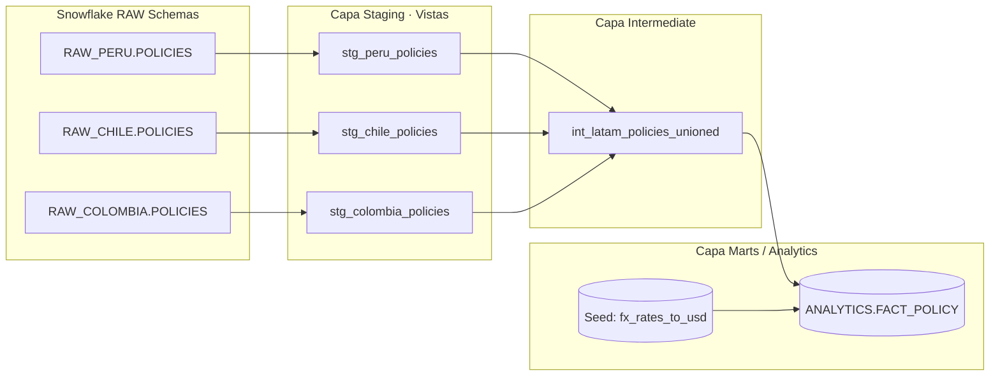
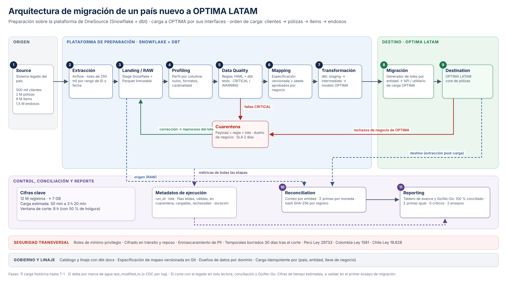

# Gallagher – Prueba Técnica de Data Engineering

Repositorio con la solución integral a los desafíos técnicos de ingeniería de datos para Gallagher: **Framework de Calidad de Datos (P1)**.

---

## Estructura del Repositorio

El repositorio está organizado modularmente para facilitar su navegación, revisión de evidencias y reproducibilidad:

- Enunciado/: Datasets CSV originales entregados: accounts.csv, legacy_policies.csv, target_policies.csv.
- Pregunta1/: Motor y scripts de validación de calidad de datos (quality_framework.py), reglas y log de ejecución (dq_execution_log.txt).

---

## Cómo Ejecutar (Reproducibilidad)

Prerrequisitos: Python 3.11 o superior.

### 1. Instalación del entorno y validaciones locales (P1)
Desde la carpeta raíz del repositorio, instala las dependencias utilizando el archivo de requerimientos ejecutando: pip install -r requirements.md

Una vez instaladas las dependencias, dirígete a la carpeta Pregunta1 y ejecuta el framework de calidad de datos escribiendo: cd Pregunta1 seguido de python quality_framework.py.
(Esto procesará los CSV ubicados en Enunciado/ preservando los formatos de texto y generará el archivo de salida dq_execution_log.txt en la misma carpeta).

Para validaciones adicionales:
- make test (Ejecuta las pruebas unitarias del motor de calidad)

---

## Punto 1: Framework de Calidad de Datos (Python)

- Implementación: Desarrollo del script quality_framework.py para la lectura segura, perfilamiento y validación de los conjuntos de datos accounts.csv, legacy_policies.csv y target_policies.csv.

### Decisiones de Diseño del Motor
- Portabilidad de Rutas: El framework utiliza resolución de rutas dinámicas mediante os.path, permitiendo su ejecución nativa en cualquier entorno o sistema operativo sin requerir rutas absolutas cableadas.
- Lectura segura de tipos (dtype=str): Los archivos CSV se procesan preservando estrictamente el formato de texto en identificadores y documentos (garantizando que no se pierdan ceros a la izquierda ni el dígito verificador K en los documentos chilenos).
- Reglas de fila, de conjunto y cruzadas: El framework evalúa tanto formatos individuales como unicidad y relaciones cruzadas (integridad referencial entre clientes y pólizas).
- Niveles de Severidad:
  * CRITICAL: Bloquea la migración del registro y lo desvía a cuarentena (DLQ).
  * WARNING: Permite migrar el registro marcándolo con una bandera de auditoría para su remediación en el origen.
- Trazabilidad y Evidencias: Generación automática del archivo de salida dq_execution_log.txt con el registro detallado de incidencias por regla, severidad y llave primaria.

### Hallazgos Principales en los Datos Entregados (Log de Ejecución Real)
La ejecución validada del framework sobre los datasets reporta las siguientes incidencias reales capturadas por el motor:

- Formato de correo inválido (Malformed_Email) en accounts | Registro: 73dd490c-d769-457f-82e7-54ac4edd0593 | Severidad: WARNING | Acción: Migrar como NULL con bandera de calidad.
- Póliza huérfana (Orphan_Policy) en target_policies | Registro: e88f1410-f52f-47fb-96bb-41751a1f5cd1 | Severidad: CRITICAL | Acción: Bloquear carga y corregir referencia del client_id.
- Resto de hallazgos históricos en accounts / legacy / target | Múltiples registros detectados por perfilamiento | Severidad: CRITICAL / WARNING | Acción: Aplicar limpieza en origen y unificación de duplicados.

## 🔍 Punto 2: Validación y Conciliación de Datos (Snowflake)

* **Implementación:** Carga de datos en Snowflake estandarizando formatos de fecha (`DD/MM/YYYY`) y tipado numérico exacto (`NUMBER(18,2)` para primas).
* **Script de Auditoría:** [`reconciliation.sql`](Pregunta2/reconciliation.sql) diseñado para auditar paridad volumétrica, financiera, integridad referencial y consistencia campo a campo.

### Resumen Ejecutivo de la Conciliación
Se identificaron **50 pólizas en origen (`legacy`)** y **49 en destino (`target`)**, con el siguiente balance de control:

| Control de Auditoría | Resultado Obtenido |
| :--- | :--- |
| **Registros Origen vs. Destino** | `50` / `49` (38 `OK`, 11 `ERROR`, 1 `MISSING_TARGET`) |
| **Pólizas no migradas (`MISSING_TARGET`)** | `POL-000041` |
| **Registros fantasma solo en destino (`MISSING_SOURCE`)** | Ninguno (`0`) |
| **Pólizas con discrepancias de atributos (`ERROR`)** | `POL-000008` (`client_id`), `POL-000030` a `037` (`start_date`), `POL-000038` (`start_date`, `end_date`), `POL-000047` (`premium`) |
| **Duplicados de pólizas (`policy_id`, `policy_number`, fila)** | Ninguno en origen ni en destino (`0`) |
| **Clientes duplicados por documento** | RUT `966030828` (Miguel Vargas) con 2 `client_id` |
| **Clientes con múltiples pólizas en el origen** | `12` clientes (detalle en [`duplicados_src.csv`](Pregunta2/duplicados_src.csv)) |
| **Suma de Primas (Origen vs. Destino)** | `$278,300.02` vs. `$264,745.87` |
| **Varianza Financiera Total** | `-$13,554.15` $\rightarrow$ explicada exactamente por `POL-000041` (`$7,215.12` no migrada) + `POL-000047` (`$6,339.03` de diferencia en prima) |
| **Pólizas huérfanas (sin cliente en `accounts`)** | `POL-000008` en destino |

### Decisiones Técnicas en SQL
* **Comparación segura ante nulos (`EQUAL_NULL`):** Un valor `NULL` en un solo lado se detecta inmediatamente como discrepancia; `NULL` en ambos lados se evalúa como igualdad.
* **Cruce simétrico (`FULL OUTER JOIN`):** Permite detectar tanto pérdidas en la extracción (`MISSING_TARGET`) como inyecciones no autorizadas en destino (`MISSING_SOURCE`).
* **Deduplicación preventiva (`QUALIFY ROW_NUMBER()`):** Evita que eventuales duplicados generen un producto cartesiano que distorsione las sumas de primas.

### 📸 Evidencias Gráficas y Archivos de Ejecución

2.1. **Conteo Volumétrico (Comparativa de registros totales):**


2.2. **Control de Nulos en Origen y Destino:**


2.3. **Registros Faltantes / Sin Migrar (`legacy` vs. `target`):**


2.4. **Control de Pólizas en Destino Inexistentes en Origen (`MISSING_SOURCE`):**


2.5. **Detección de Duplicados en Origen y Destino:**


2.6. **Clientes con más de una póliza en el origen:**
* Exportación de clientes con múltiples pólizas activas/históricas en el sistema legado: [`duplicados_src.csv`](Pregunta2/duplicados_src.csv).

2.7. **Auditoría Detallada Campo por Campo:**
* Validación a nivel de atributo (`premium`, `currency`, `start_date`, `end_date`, `status`) clasificada por estado (`OK` / `ERROR`): [`Auditoria.csv`](Pregunta2/Auditoria.csv).

---

## 🏗️ Punto 3: Consolidación Regional LATAM con dbt (OneSource)

Diseño de arquitectura modular en **dbt** para estandarizar e integrar las tablas regionales de seguros (`RAW_PERU.POLICIES`, `RAW_CHILE.POLICIES`, `RAW_COLOMBIA.POLICIES`) en el modelo analítico corporativo **`ANALYTICS.FACT_POLICY`**.

### 📊 1. Diagrama de Linaje (dbt Lineage)



### 🏛️ 2. Arquitectura en Capas y Responsabilidades

| Capa | Materialización | Responsabilidad Técnica |
| :--- | :---: | :--- |
| **Sources (`_sources.yml`)** | Tablas RAW | Declaración de fuentes por esquema de país con monitoreo de frescura (*freshness*). |
| **Staging (`models/staging/`)** | Vistas (`view`) | Renombrado al estándar corporativo, casteo de fechas/números y homologación de estados/monedas. Los valores faltantes o inválidos se conservan como `NULL` con banderas de alerta (sin alterar métricas financieras con ceros artificiales). |
| **Intermediate (`models/intermediate/`)** | Efímero / Vista | Unificación (`UNION ALL`) de los esquemas regionales ya estandarizados y aplicación de reglas transversales. |
| **Marts (`models/marts/`)** | Tabla (`table`) | Construcción de `ANALYTICS.FACT_POLICY` con grano definido (una fila por póliza y país), llave subrogada (`policy_sk`), prima en moneda local y homologada en `USD`, y metadatos de linaje. |

### 📂 3. Estructura del Proyecto y Código Fuente

```text
gallagher_transform/
├── dbt_project.yml
├── profiles.yml
└── models/
    ├── staging/
    │   ├── _sources.yml
    │   ├── stg_peru_policies.sql
    │   ├── stg_chile_policies.sql
    │   └── stg_colombia_policies.sql
    ├── intermediate/
    │   └── int_latam_policies_unioned.sql
    └── marts/
        └── fact_policy.sql
```

**Enlaces directos a la implementación en este repositorio:**
* **[Definición de Fuentes (`_sources.yml`)](Pregunta3/_sources.yml):** Mapeo de las tablas originales para Perú, Chile y Colombia.
* **[Modelo Staging – Ejemplo Colombia (`stg_colombia_policies.sql`)](Pregunta3/stg_colombia_policies.sql):** Limpieza, conversión de tipos de datos, normalización de vigencias y manejo seguro de nulos.
* **[Modelo Intermedio (`int_latam_policies_unioned.sql`)](Pregunta3/int_latam_policies_unioned.sql):** Integración regional mediante `UNION ALL`.
* **[Modelo Final Analytics (`fact_policy.sql`)](Pregunta3/fact_policy.sql):** Tabla corporativa final con llave subrogada (`policy_sk`) y auditoría para consumo de OneSource en BI.

### 🎯 4. Justificación de Decisiones y Controles en dbt
1. **Modularidad y Aislamiento:** Aislar cada país en *staging* permite absorber cambios locales (ej. si Perú modifica su formato de fecha) sin tocar la lógica intermedia ni el reporte corporativo.
2. **Escalabilidad Geográfica:** Integrar un nuevo país a OneSource solo requiere agregar su vista `stg_<pais>_policies.sql` e incluirla en el modelo intermedio.
3. **Calidad Integrada (Data Tests):** Pruebas declarativas `unique` y `not_null` en llaves primarias, `accepted_values` en códigos de país, moneda y estatus, y validación de coherencia de fechas.
4. **Supuesto de Conversión Monetaria:** Para consolidar reportes regionales, se contempla el cruce con tasas de cambio (`fx_rates_to_usd`) gobernadas por el área de Finanzas según la fecha de emisión o inicio de vigencia.

---

## 🚀 Punto 4: Diseño End-to-End para Migración Masiva (OPTIMA LATAM)

Solución de arquitectura para incorporar un nuevo país a la plataforma transaccional y analítica **OPTIMA LATAM**, gestionando un volumen estimado de **500,000 clientes, 2,000,000 de pólizas, 8,000,000 de ítems y 1,500,000 de endosos (~12 millones de registros / $\approx 7\text{ GB}$)**.

### 🏗️ 1. Diagrama de Arquitectura End-to-End




### 📋 2. Descripción de Componentes y Funciones del Pipeline

| Etapa / Componente | Tecnología de Referencia (Agnóstica / Adaptable) | Función Principal y Responsabilidad Técnica |
| :--- | :--- | :--- |
| **1. Source (Origen)** | RDBMS Legado (PostgreSQL / Oracle / SQL Server) | Sistema transaccional del país a migrar. Aloja los datos históricos de clientes (500k), pólizas (2M), ítems (8M) y endosos (1.5M). |
| **2. Extraction (Extracción)** | Apache Airflow / Python Extractors (o ADF) | Orquesta extracciones concurrentes y particionadas por rangos de ID o fecha en lotes controlados para evitar bloqueos en la base productiva. |
| **3. Landing / RAW (Aterrizaje)** | MinIO / S3 / ADLS Gen2 (Formato Parquet) | Zona de almacenamiento inmutable (*Bronze Layer*) que recibe los datos crudos comprimidos con Snappy, garantizando desacoplamiento y persistencia para auditorías. |
| **4. Profiling (Perfilamiento)** | Python Profiler (Pandas/Polars) / SQL | Análisis exploratorio automatizado previo a la carga: distribución de nulos, detección de formatos atípicos y cardinalidad de llaves foráneas. |
| **5. Pre-ingestion Data Quality** | Great Expectations / Validadores Schema | Control preventivo de calidad estructural: verificación de tipados, no nulidad de identificadores críticos y detección temprana de esquemas corruptos. |
| **6. Mapping (Homologación)** | dbt Seeds / Tablas Maestras de Catálogo | Matriz de correspondencia corporativa que traduce catálogos locales (ramos, monedas, planes, tipos de documento) a los estándares globales de OPTIMA. |
| **7. Transformation (Transformación)** | dbt Core (Staging $\rightarrow$ Intermediate $\rightarrow$ Marts) | Procesamiento modular en SQL versionado. Limpieza de textos, normalización de vigencias, generación de llaves subrogadas (`Surrogate Keys`) y reglas de negocio. |
| **7.1. Dead Letter Queue (DLQ)** | Tablas de Cuarentena (Snowflake / PostgreSQL) | Aislamiento automático de registros que incumplen reglas críticas o presentan referencias huérfanas, guardando el payload crudo, el código de error y el timestamp sin detener el pipeline. |
| **8. Migration (Carga)** | Pipeline ELT Idempotente (`MERGE` / Bulk API) | Ejecución controlada en fases: carga masiva histórica en frío (*Bulk Load* hasta $T-1$) y sincronización incremental final (*Delta Sync*) durante la ventana de corte. |
| **9. Destination (Destino)** | OPTIMA LATAM (Core Transaccional + Snowflake) | Plataforma destino que recibe las entidades validadas respetando el orden de integridad referencial y habilita la capa analítica de OneSource. |
| **10. Reconciliation (Conciliación)** | Engine de Conciliación SQL / Python | Auditoría automatizada de paridad volumétrica, cuadre financiero ($\sum \text{Premium}$) y validación registro a registro mediante hash (`SHA256`). |
| **11. Reporting & Observability** | Superset / Power BI + Prometheus / Grafana | Tablero ejecutivo en tiempo real para monitoreo de *throughput* (registros/seg), métricas de DLQ y firma del certificado de salida a producción (*Go/No-Go*). |

### 💡 3. Justificación Tecnológica: Enfoque Agnóstico y Aprovechamiento de Licencias

Se diseñó una arquitectura modular basada en estándares abiertos (archivos Parquet, transformación SQL con dbt y orquestación por grafos DAG) por dos razones estratégicas:
1. **Cero dependencia de proveedor (*Zero Vendor Lock-in*):** Toda la lógica de negocio y calidad es 100% portátil.
2. **Adaptabilidad inmediata al ecosistema de Gallagher:** El diseño funciona como un plano maestro que aprovecha la infraestructura ya contratada por la corporación. Si la filial opera sobre el stack corporativo de **OneSource (Snowflake + Azure/AWS)**, el *Landing* se monta sobre ADLS/S3 y el cómputo recae directamente sobre Snowflake; si un país tiene restricciones regulatorias locales, puede ejecutarse *on-premises* con contenedores sin reescribir una sola línea de código, pagando únicamente por el almacenamiento y cómputo utilizados.

### 🛠️ 4. Estrategias Técnicas de Ejecución

* **Manejo de Grandes Volúmenes (~12M de registros / $\approx 7\text{ GB}$):** Extraemos los datos particionados por lotes en archivos Parquet comprimidos (100–250 MB) para no saturar la base de datos de origen. La inyección en destino sigue una cascada relacional estricta para evitar registros huérfanos:
  $$\text{1. Clientes (500k)} \longrightarrow \text{2. Pólizas (2M)} \longrightarrow \text{3. Endosos (1.5M) e Ítems (8M)}$$
* **Control de Calidad de Datos (Data Quality):** Validamos en tres barreras automáticas:
  1. *Estructural:* Sin llaves nulas ni duplicados físicos.
  2. *Relacional:* Todo ítem o endoso debe apuntar a una póliza válida, y toda póliza a un cliente existente.
  3. *Negocio:* Coherencia temporal ($\text{start\_date} \le \text{end\_date}$), primas no negativas y catálogos homologados.
* **Manejo de Errores y Reprocesamiento (DLQ + Idempotencia):** Si un registro falla una regla crítica, no detiene los 12 millones restantes; se desvía automáticamente a una tabla de **cuarentena (DLQ)** con el detalle del error para que negocio lo corrija. Además, todas las cargas usan operaciones **idempotentes (`MERGE INTO`)** basadas en llaves de negocio: si la red cae y se relanza el proceso, o si se reinyectan registros corregidos desde la DLQ, nunca se duplican los datos ($f(f(x)) = f(x)$).
* **Estrategia de Migración (Lotes + Delta Incremental):** Para no afectar la operación diaria del país, la migración se divide en tres etapas:
  1. *Carga histórica en frío (Bulk Load):* Migra el ~95% de la historia hasta el corte $T-1$ en horario no hábil.
  2. *Sincronización Incremental (Delta Sync):* Captura periódicamente solo los registros nuevos o modificados (vía marca de agua `updated_at` o CDC).
  3. *Ventana de Corte (Cutover de ~8 horas en fin de semana):* Se pone el sistema legado en modo solo lectura (*Read-Only*), se procesa el último delta (tiempo estimado de carga total entre 50 min y 3 h 20 min según el *throughput* del destino), se ejecuta la conciliación y se activa OPTIMA LATAM.
* **Seguridad y Gobierno de Datos (PII):** Cifrado en tránsito (TLS 1.2+) y en reposo (AES-256), roles de mínimo privilegio (RBAC) y enmascaramiento dinámico (*Dynamic Data Masking*) sobre datos personales (nombres, documentos, correos y teléfonos) en entornos no productivos, cumpliendo las normativas locales de protección de datos de Perú (Ley 29733), Colombia (Ley 1581) y Chile (Ley 19.628).
* **Conciliación entre Origen y Destino:** Cuadre automático en tres ejes:
  1. *Balance volumétrico exacto:* $\text{Origen} = \text{Destino} + \text{DLQ}$.
  2. *Cuadre financiero al centavo:* $\sum \text{Premium}_{\text{Origen}} \equiv \sum \text{Premium}_{\text{Destino}}$ por moneda y ramo.
  3. *Paridad campo a campo:* Comparación de huellas criptográficas (`SHA256`) entre los atributos normalizados.
* **Métricas y Criterios Go/No-Go:** Monitoreo en tiempo real de la velocidad de ingesta (*throughput*) y del porcentaje de rechazos en un tablero ejecutivo. La salida a producción (**Go-Live**) exige cumplir cinco criterios de aceptación:
  1. 100% de los registros conciliados (migrados o documentados en DLQ).
  2. Varianza financiera igual a `$0.00` en primas activas.
  3. Cero errores de severidad `CRITICAL` pendientes de resolución.
  4. Al menos dos simulacros previos (*Dry Runs*) exitosos.
  5. Plan de contingencia y reversa (*Rollback*) validado.
