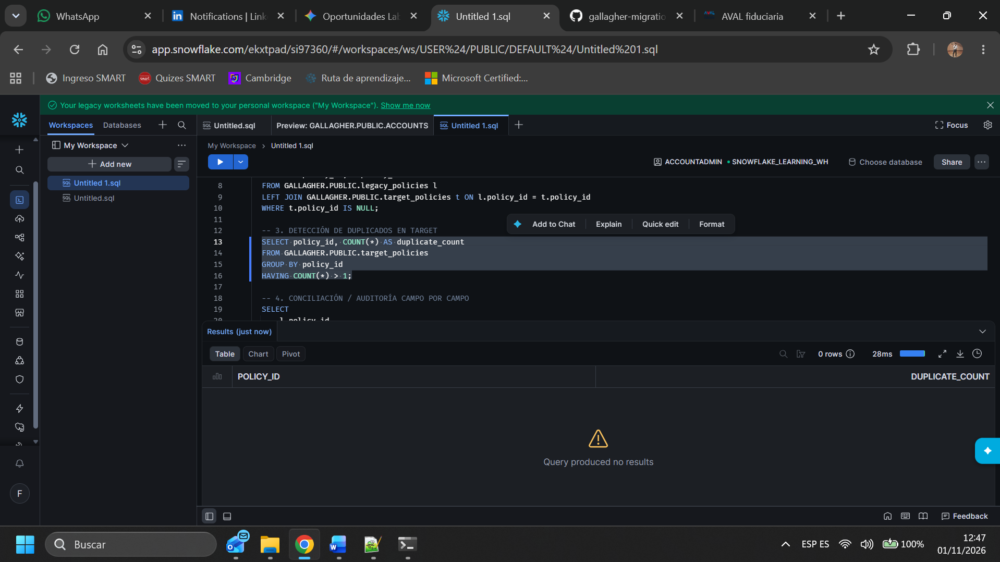
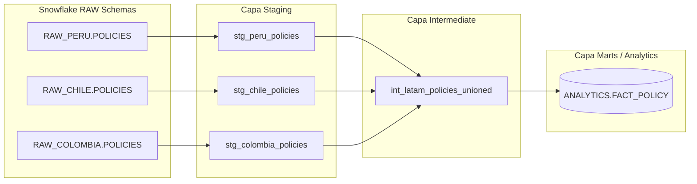
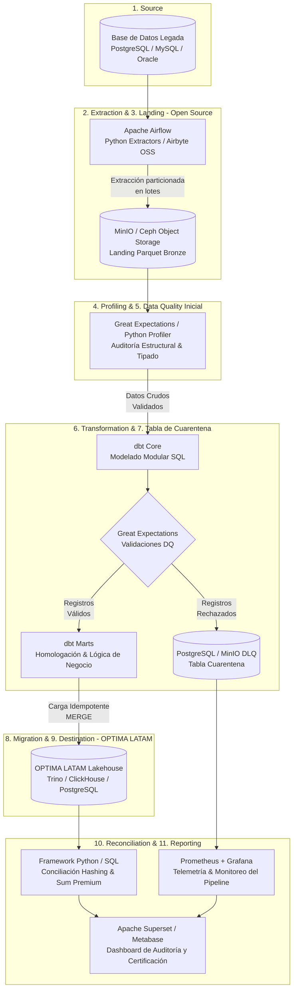

# Gallagher Data Engineering Technical Assessment

## Descripción del Proyecto
Este repositorio contiene la solución para la prueba técnica de ingeniería de datos para Gallagher, enfocada en la migración, validación y conciliación de pólizas.

## Progreso y Componentes

- **Punto 1: Procesamiento Inicial con Python**
  - Implementación de scripts en Python (`quality_framework.py`) para la lectura, análisis y preparación de los conjuntos de datos (`legacy_policies` y `target_policies`).

- **Punto 2: Validación y Conciliación de Datos (Snowflake)**
  - Carga de datos en Snowflake manejando los formatos de fecha `DD/MM/YYYY`.
  - Script implementado en `reconciliation.sql` para auditar la integridad de la migración.

  ### Evidencias Gráficas (Imágenes):
  2.1. **Conteo Volumétrico (Comparativa de registros totales):**
     

  2.2. **Registros Faltantes / Sin Migrar (Pólizas en legacy no encontradas en target):**
     

  2.3. **Detección de Duplicados en el Destino:**
     

  ### Resultados y Análisis Detallados (Archivos CSV):
  
  2.4. **Análisis de Clientes (`Clientes con mas de una poliza en el origen.csv`):**
     - Identificación de clientes que poseen más de una póliza registrada dentro del sistema legacy.
    
  2.5. **Auditoría Campo por Campo (`Auditoria.csv`):**
     - Validación detallada de atributos críticos (`premium`, `currency`, `start_date`, `end_date`, `status`) con indicadores de estatus (`OK` / `ERROR`).

 - **Punto 3: Arquitectura y Modelado en dbt (Consolidación LATAM - OneSource)**
  - Diseño de arquitectura en capas utilizando dbt para estandarizar y consolidar las fuentes regionales (`RAW_PERU.POLICIES`, `RAW_CHILE.POLICIES`, `RAW_COLOMBIA.POLICIES`) en un único dataset analítico corporativo: `ANALYTICS.FACT_POLICY`.

  ### 🏗️ 1. Arquitectura en Capas
  La solución propuesta en dbt, consiste en tres capas principales:

  * **Capa Staging (`models/staging/`):** 
    * Conexión directa a las tablas RAW de cada país.
    * Estandarización de nombres de columnas, normalización de tipos de datos, limpieza de valores nulos y estandarización de monedas y estados.
  * **Capa Intermediate (`models/intermediate/`):** 
    * Realiza el cruce y unificación (`UNION ALL`) de los datos limpios provenientes de los diferentes países.
    * Aplica lógica de negocio transversal antes de llegar al modelo final.
  * **Capa Marts / Analytics (`models/marts/`):** 
    * Genera la tabla analítica final materializada como tabla (`ANALYTICS.FACT_POLICY`) lista para herramientas de BI y consumo corporativo de OneSource.

  ---

  ### 📂 2. Estructura del Proyecto dbt
  ```text
  gallagher_transform/
  ├── dbt_project.yml
  ├── profiles.yml
  └── models/
      ├── staging/
      │   ├── _sources.yml
      │   ├── stg_peru_policies.sql
      │   ├── stg_chile_policies.sql
      │   └── stg_colombia_policies.sql
      ├── intermediate/
      │   └── int_latam_policies_unioned.sql
      └── marts/
          └── fact_policy.sql
```
### 💻 3. Implementación de Modelos Clave (Código Fuente)

  Para la evaluación de esta arquitectura, se muestra el código fuente de los modelos adjuntos en este repositorio haciendo clic en los siguientes enlaces:

  * **[Definición de Fuentes (`_sources.yml`)](_sources.yml):** Configuración y mapeo de las tablas originales en el esquema `RAW_DB` para Perú, Chile y Colombia.
  * **[Modelo Staging - Ejemplo Colombia (`stg_colombia_policies.sql`)](stg_colombia_policies.sql):** Lógica de limpieza, casteo de formatos de fecha, manejo de nulos y estandarización de la fuente colombiana.
  * **[Modelo Intermedio (`int_latam_policies_unioned.sql`)](int_latam_policies_unioned.sql):** Integración (`UNION ALL`) de las tablas regionales estandarizadas en una única capa unificada.
  * **[Modelo Final Analytics (`fact_policy.sql`)](fact_policy.sql):** Construcción de la tabla final corporativa con generación de llaves  (`policy_sk`) y metadata de actualización para OneSource.

  ### 🎯  Justificación de Decisiones de Diseño
  1. **Modularidad y Reutilización:** Aislar las fuentes por país en la capa de *staging* permite absorber cambios en los sistemas locales (ej. si Perú cambia el formato de fecha) sin alterar los modelos intermedios ni los reportes finales.
  2. **Estandarización Temprana:** La limpieza de nulos (`COALESCE`), el casteo de tipos y la normalización de textos se ejecutan al inicio, garantizando que el consumo analítico sea consistente en las capas superiores.
  3. **Escalabilidad Geográfica:** Incorporar un nuevo país a la plataforma OneSource solo requiere la creación de un nuevo script `stg_<pais>_policies.sql` y su incorporación en el `UNION ALL` del modelo intermedio, manteniendo intacta la lógica de negocio de la tabla final (`fact_policy.sql`).


### 📊 Diagrama de Arquitectura (Lineage dbt)


- **Punto 4: Diseño de Solución End-to-End para Migración Masiva (OPTIMA LATAM)**

Solución de arquitectura para la incorporación masiva de un nuevo país a la plataforma corporativa OPTIMA LATAM, gestionando una volumetría estimada de **500,000 clientes, 2,000,000 de pólizas, 8,000,000 de ítems y 1,500,000 de endosos (~12 millones de registros en total)**.

### 🏗️ 1. Diagrama de Arquitectura End-to-End


